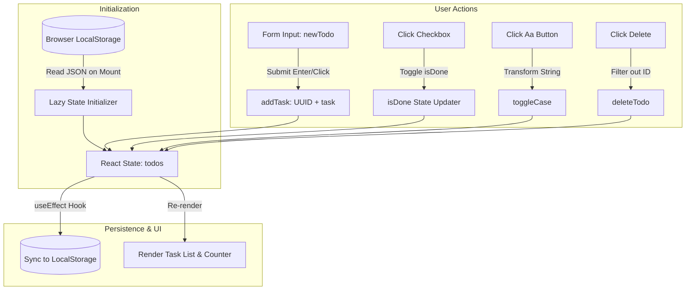

# 📝 Todo App — Responsive Task Management Dashboard

A responsive task management application built with **React 19**, **Bootstrap 5**, and browser **LocalStorage** persistence. Demonstrates clean React design patterns, immutable state updates, form accessibility, and interactive task operations.

---

## 📑 Table of Contents
- [Overview](#-overview)
- [Key Features](#-key-features)
- [Architecture & State Flow](#-architecture--state-flow)
- [Tech Stack](#-tech-stack)
- [Project Structure](#-project-structure)
- [Getting Started](#-getting-started)
- [Engineering Highlights & Interview Talking Points](#-engineering-highlights--interview-talking-points)
- [Author & Contact](#-author--contact)

---

## 🌟 Overview

The **Todo App** goes beyond basic CRUD demos by incorporating client-side persistent storage, atomic state mutations, keyboard accessibility, and batch operations. Even upon browser refresh or tab closure, user tasks remain fully intact via persistent browser `localStorage`.

---

## ✨ Key Features

- **⚡ Instant Task Creation:** Add tasks smoothly with enter-key form submission and whitespace sanitization.
- **💾 LocalStorage Synchronization:** Automatic state hydration on mount and debounced synchronization on every mutation.
- **✅ Individual & Batch Toggling:**
  - Mark individual tasks complete/incomplete with interactive checkboxes.
  - One-click **Toggle All Done** to batch flip completion status across all items.
- **🔤 Dynamic Text Transformation:** In-place case toggle (`Aa` / `AA`) demonstrating per-item immutable transformations.
- **🗑️ Safe Task Removal & Wipe:** Remove individual tasks or clear all with user confirmation.
- **📱 Responsive Layout:** Styled with Bootstrap 5 cards, flexbox alignment, and responsive badge indicators.

---

## 🏗️ Architecture & State Flow



---

## 🛠️ Tech Stack

| Technology | Role | Details |
|---|---|---|
| **React 19** | Core UI Engine | Functional components with Hooks (`useState`, `useEffect`) |
| **Vite 7** | Frontend Tooling | Lightning-fast development server and optimized build |
| **Bootstrap 5** | CSS Framework | Responsive card layouts, form controls, and badges |
| **UUID (v4)** | Unique Identifier | Cryptographically strong unique IDs for stable React key props |
| **HTML5 LocalStorage** | Client Persistence | Key-value browser storage for data durability |

---

## 📁 Project Structure

```
Todo-App/
├── public/                 # Static assets
├── src/
│   ├── assets/             # Images and preview screenshots
│   ├── App.css             # Main styling
│   ├── App.jsx             # Root application wrapper
│   ├── index.css           # Global typography & layout reset
│   ├── main.jsx            # React 19 root bootstrap
│   └── Todo.jsx            # Core Todo component & state engine
├── .gitignore              # Ignored files (node_modules, dist)
├── index.html              # HTML shell with Bootstrap 5 CDN
├── package.json            # Manifest & dependencies
└── vite.config.js          # Vite build configuration
```

---

## 🚀 Getting Started

### 1. Prerequisites
- **Node.js**: v18.0.0 or higher
- **npm** or **yarn**

### 2. Installation & Run
```bash
# Clone the repository
git clone https://github.com/aditya-life/Todo-App.git

# Navigate into project folder
cd Todo-App

# Install dependencies
npm install

# Start Vite dev server
npm run dev
```

Visit `http://localhost:5173` to explore the app.

### 3. Production Build
```bash
npm run build
npm run preview
```

---

## 🎯 Engineering Highlights & Interview Talking Points

When discussing this project during technical interviews:

1. **Lazy State Initialization (`useState(callback)`):**
   - *Explanation:* Instead of reading `localStorage.getItem` synchronously on every re-render, the initialization logic is passed as a function to `useState(() => ...)`. This ensures `localStorage` is only queried once during initial mount, avoiding expensive I/O operations on subsequent renders.
2. **Pure Immutability in State Updates:**
   - *Explanation:* React requires state updates to produce new references. All array modifications leverage non-mutating methods like `.map()` and `.filter()`, avoiding direct mutations like `.push()` or `.splice()`.
3. **Defending Against State Stale Closures:**
   - *Explanation:* All setter functions (`setTodos(prevTodos => ...)`) use the functional updater pattern, ensuring that rapid consecutive deletions or toggles operate on the latest state rather than a stale closure.
4. **Stable Keys via UUID:**
   - *Explanation:* Avoided using array indexes (`index`) as React keys, which is an anti-pattern when list items are filtered or deleted. Using `uuidv4()` ensures React reconciles list DOM elements predictably without unexpected UI glitches.

---

## 👤 Author & Contact

**Aditya Kumar**
- **GitHub:** [@aditya-life](https://github.com/aditya-life)
- **LinkedIn:** [Aditya Kumar](https://www.linkedin.com/in/aditya-life)
- **Email:** aditya12186@gmail.com
